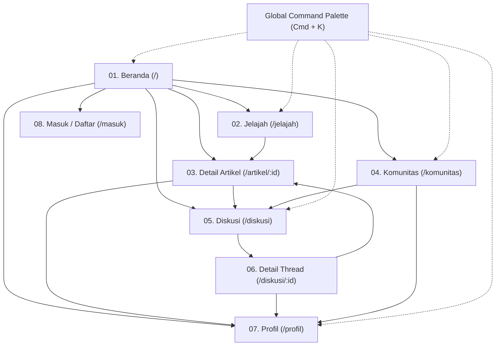

# DESIGN SYSTEM & ARCHITECTURE SPECIFICATION
## RuangAksara: Perpustakaan di Hari Hujan (Rainy Day Library)

> **Dokumen Analisis Desain Final (Desktop & Mobile)**  
> Dibuat berdasarkan ekstraksi dan analisis 16 screen referensi dari Google Stitch (`projects/17457177883114590262`), dipadukan dengan visi rancangan pada `IDEA.md`.

---

## 1. Brand Identity & Design Philosophy

RuangAksara adalah ruang virtual yang hangat dan estetis untuk pencinta buku. Pendekatan desain menggabungkan dua filosofi utama:
1. **Literary Neoclassicism (Inspirasi: Literal.club):** Buku adalah "pahlawan" utama antarmuka. Komponen kartu buku mensimulasikan proporsi buku fisik lengkap dengan punggung buku (*spine*), tekstur penjilidan kain, aksen tipografi serif yang elegan, dan visual rak buku (*bookshelf*).
2. **Linear-Precision Glassmorphism (Inspirasi: Linear.app):** Antarmuka yang tenang dan presisi. Menggunakan garis batas halus berukuran 1px (*hairline border*) dengan opasitas rendah (`rgba(42, 107, 101, 0.08)`), bayangan lembut bernuansa warna alam (bukan abu-abu industri), panel kaca buram (*glassmorphic backdrop blur*), animasi *spring* organik, serta Command Palette global (`Cmd+K`).

---

## 2. Color Palette (Rainy Day Library)

Palet warna dirancang untuk membangkitkan suasana tenang seperti membaca di sudut perpustakaan saat hujan turun, ditemani secangkir teh hangat.

### 2.1 Core Palette Tokens
| Token Name | Hex / Value | Deskripsi & Penggunaan |
|---|---|---|
| `primary` | `#2A6B65` | **Cozy Teal**: Aksi utama (CTA), brand accent, status aktif tab, header brand. |
| `primary-dark` | `#1F524D` | **Deep Teal**: Hover state tombol primary, aksen bayangan tepi spine buku. |
| `primary-light` | `#D4EBE8` | **Soft Mint**: Latar belakang chip "Resensi", glow halus kartu, hover state link. |
| `on-primary` | `#F5F9F8` | **Off-White**: Warna teks di atas latar warna primary. |
| `secondary` | `#5A829A` | **Cozy Slate Blue**: Indikator progres baca, badge sekunder, variasi warna punggung buku. |
| `secondary-light` | `#D8E4ED` | **Soft Blue**: Latar badge "Wawancara", avatar placeholder, hover state sekunder. |
| `secondary-container` | `#B9E2FD` | Variasi aksen kontainer sekunder. |
| `tertiary` | `#D4A373` | **Warm Sand**: Aksen perayaan (bintang rating, tag "Baru", lencana pencapaian). |
| `on-tertiary` | `#4A3728` | **Dark Walnut**: Warna teks dengan kontras aman di atas latar warna tertiary. |
| `rose` | `#E8B4B0` | **Dusty Rose**: Emotive accent untuk ikon suka/hati (`favorite`), tag karya puisi & sastra. |
| `background` | `#F5F9F8` | **Soft Minty Cream**: Warna latar utama seluruh aplikasi (menghindari kelelahan mata). |
| `surface` | `#FFFFFF` | **Pure Soft White**: Kartu konten, modal, input surface. |
| `surface-variant` | `#E8EFED` | **Soft Sage-Gray**: Border kartu, garis batas pemisah, latar tombol netral. |
| `surface-dim` | `#C4E0DC` | Latar kontainer bertingkat rendah. |
| `on-surface` | `#1A3331` | **Deep Teal-Black**: Teks utama (jauh lebih lembut dibanding hitam pekat `#000000`). |
| `on-surface-variant` | `#5A7A76` | **Muted Teal-Gray**: Teks pendukung, nama penulis, tanggal, dan metadata. |
| `error` | `#BA1A1A` | Status gagal, peringatan validasi form. |

### 2.2 Glassmorphic & Border Effects
* **Hairline Border (`border-subtle`):** `1px solid rgba(42, 107, 101, 0.08)`
* **Frosted Glass Panel (`glass`):** `background: rgba(255, 255, 255, 0.65)` dipadukan dengan `backdrop-filter: blur(12px)`
* **Elevated Glass Strong (`glass-strong`):** `background: rgba(255, 255, 255, 0.85)` dipadukan dengan `backdrop-filter: blur(20px)`
* **Ambient Glow Tint:** `box-shadow: 0 12px 32px rgba(42, 107, 101, 0.08), 0 2px 8px rgba(26, 51, 49, 0.04)`

### 2.3 Semantic Tag Color Matrix
* **Resensi:** Background `#D4EBE8` (`primary-light`) • Text `#2A6B65` (`primary`)
* **Wawancara:** Background `#D8E4ED` (`secondary-light`) • Text `#5A829A` (`secondary`)
* **Warta / Pengumuman:** Background `#FFDCBD` (`tertiary-fixed`) • Text `#4A3728` (`on-tertiary`)
* **Karya / Puisi:** Background `rgba(232, 180, 176, 0.4)` (`rose/40`) • Text `#5E2B27`

---

## 3. Typography Scale & Guidelines

Tipografi mengombinasikan keanggunan literatur klasik dengan kenyamanan membaca digital modern.

* **Headlines, Display, Quotes & Book Titles:** `Noto Serif` (Humanist serif organik dengan tracking proporsional).
* **Body Text, Navigation, Chips, Inputs & Buttons:** `Nunito Sans` (Aperture terbuka, sangat terbaca di layar desktop maupun ponsel).

### 3.1 Type Scale Hierarchy
| Level | Font Family | Size (Desktop / Mobile) | Weight | Line Height | Letter Spacing |
|---|---|---|---|---|---|
| **display** | Noto Serif | `3.5rem (56px)` / `2.25rem (36px)` | 700 (Bold) | `1.15` | `-0.02em` |
| **headline-lg** | Noto Serif | `2.5rem (40px)` / `1.875rem (30px)` | 700 (Bold) | `1.2` | `-0.01em` |
| **headline-md** | Noto Serif | `1.75rem (28px)` / `1.5rem (24px)` | 600 (SemiBold) | `1.3` | `normal` |
| **headline-sm** | Noto Serif | `1.25rem (20px)` / `1.125rem (18px)` | 600 (SemiBold) | `1.4` | `normal` |
| **quote** | Noto Serif | `1.5rem (24px)` / `1.25rem (20px)` | 500 (Medium) Italic | `1.5` | `normal` |
| **body-lg** | Nunito Sans | `1.125rem (18px)` | 400 (Regular) | `1.7` | `normal` |
| **body-md** | Nunito Sans | `1.0rem (16px)` | 400 (Regular) | `1.7` | `normal` |
| **body-sm** | Nunito Sans | `0.875rem (14px)` | 400 (Regular) | `1.6` | `normal` |
| **label-lg** | Nunito Sans | `1.0rem (16px)` | 600 (SemiBold) | `1.3` | `normal` |
| **label-md** | Nunito Sans | `0.9375rem (15px)` | 600 (SemiBold) | `1.2` | `normal` |
| **label-sm** | Nunito Sans | `0.8125rem (13px)` | 600 (SemiBold) | `1.2` | `0.02em` |
| **code-kbd** | Nunito Sans | `0.75rem (12px)` | 700 (Bold) | `1.0` | `0.04em` |

---

## 4. Spacing, Shapes & Elevation

### 4.1 Spacing Rhythm (8-Point Grid)
* `space-xs`: `0.25rem` (4px) — micro padding badge & chip
* `space-sm`: `0.5rem` (8px) — jarak ikon & teks, celah rating
* `space-md`: `1.0rem` (16px) — padding internal kartu mobile, input gap
* `space-lg`: `1.5rem` (24px) — padding kartu desktop, gutter mobile
* `space-xl`: `2.0rem` (32px) — jarak antar-seksi mobile, gutter desktop
* `space-2xl`: `3.0rem` (48px) — jarak seksi desktop sedang
* `space-3xl`: `4.0rem` (64px) — batas vertical hero seksi
* `space-4xl`: `6.0rem` (96px) — margin atas footer dan jeda narasi besar

### 4.2 Shapes & Corner Radii
* `rounded-sm` (6px): Sampul buku, punggung buku fisik, tombol pintasan keyboard (`<kbd>`).
* `rounded-md` (12px): Field form input, kartu ringkasan kecil.
* `rounded-lg` (16px): Kartu artikel, kartu klub buku, thread forum panel.
* `rounded-2xl` (24px): Kartu hero, modal jendela Command Palette, auth dialog.
* `rounded-full` (9999px): Seluruh tombol aksi utama/sekunder, tab pill, badge kategori, indikator pagination bulat.

---

## 5. Komponen Utama Antarmuka

### 5.1 Kartu Buku Fisik Realistis (*Physical Book Simulation Card*)
* **Spine:** Lebar 14px–18px di sisi kiri, `rounded-l-sm`, diberi gradien gelap halus `rgba(0,0,0,0.2)` yang meniru lipatan kain sampul.
* **Cover:** Berisi judul buku dalam font serif kapital vertikal, nama penulis, dan garis hairline pemisah.
* **Leaf Trim:** Sisi kanan memiliki strip 3px yang meniru lembaran kertas buku.
* **Hover Micro-interaction:** Hover memicu elevasi `translateY(-6px) rotateY(-2deg)` dengan spring physics `cubic-bezier(0.34, 1.56, 0.64, 1)` dan pendaran teal ambient.

### 5.2 Rak Buku Grafis Interaktif (*Bookshelf Spine Chart*)
* Batang vertikal warna-warni yang mewakili buku-buku berbeda (Tinggi 48px–88px) bersandar di atas papan rak horizontal (`bg-surface-variant`, tinggi 10px).
* Berfungsi sebagai visualisasi statistik membaca di Beranda dan Rak Buku di halaman Profil.

### 5.3 Command Palette Modal (`Cmd+K` / `Ctrl+K`)
* Jendela modal melayang di tengah layar (`max-w-[640px]`, `max-h-[480px]`), menggunakan permukaan `glass-strong` dengan blur 20px.
* Menyediakan pencarian cepat dengan navigasi keyboard (`↑`, `↓`, `Enter`, `Esc`), terbagi menjadi 3 kategori: Navigasi Cepat, Buku Populer, dan Komunitas.

### 5.4 Tombol Pill & Filter Chips
* **Tombol Utama:** Tinggi 44px, `rounded-full`, warna `primary` (`#2A6B65`), teks `on-primary` (`#F5F9F8`). Hover berganti warna menjadi `primary-dark` (`#1F524D`) dengan translasi `translateY(-1px)`.
* **Tombol Sekunder:** Tinggi 44px, `rounded-full`, latar transparan dengan garis batas 1px `surface-variant`.
* **Category Chips:** Tinggi 28px, padding `4px 12px`, `rounded-full`, font `label-sm`.

---

## 6. Layout Halaman & Pasangan Desktop - Mobile

Delapan halaman inti diperlakukan sebagai variasi responsif dari halaman yang sama:

```
┌────────────────────────────────────────────────────────────────────────┐
│                        DAFTAR 8 HALAMAN UTAMA                          │
├─────┬───────────────────────────┬──────────────────────────────────────┤
│ No  │ Nama Halaman              │ Rute Aplikasi Target                 │
├─────┼───────────────────────────┼──────────────────────────────────────┤
│ 01  │ Beranda (Home)            │ /                                    │
│ 02  │ Jelajah (Explore/Catalog) │ /jelajah                             │
│ 03  │ Detail Artikel / Buku     │ /artikel/:slug                       │
│ 04  │ Komunitas (Book Clubs)    │ /komunitas                           │
│ 05  │ Diskusi (Forum Feed)      │ /diskusi                             │
│ 06  │ Detail Thread Diskusi     │ /diskusi/:threadId                   │
│ 07  │ Profil & Rak Buku         │ /profil                              │
│ 08  │ Masuk / Daftar (Auth)     │ /masuk                               │
└─────┴───────────────────────────┴──────────────────────────────────────┘
```

---

### Halaman 01: Beranda (`/`)
* **Tujuan:** Menghadirkan *first impression* hangat, kutipan pekan ini, kurasi tulisan segar, dan klub buku aktif.
* **Layout Desktop (`max-w-[1140px]`):**
  * *Top Navigation:* Fixed glass bar dengan logo RuangAksara, link navigasi (Beranda, Jelajah, Diskusi, Komunitas), Search Bar `Cmd+K`, tombol "Gabung", dan avatar profil.
  * *Hero Section:* Latar radial gradient blur orbs, badge "Perpustakaan di Hari Hujan", judul display besar 2 baris, dan 2 tombol CTA ("Gabung" & "Jelajah Tulisan").
  * *Floating Stat & Bookshelf Panel:* Panel kaca bergradien dengan 3 angka statistik (2.480 Tulisan, 1.126 Pembaca, 86 Klub) dan rak buku grafis interaktif.
  * *Tulisan Segar:* Grid 3 kolom kartu buku (Resensi, Wawancara, Warta, Karya).
  * *Kutipan Hari Ini:* Banner kutipan berbobot serif miring di tengah layar.
  * *Klub Buku:* Grid 3 kolom kartu klub buku lengkap dengan jadwal dan avatar tumpuk (*stacked avatars*).
  * *Footer:* Banner penutup "Ada buku yang sedang menunggumu" dan footer navigasi.
* **Layout Mobile (`390px`):**
  * *Header Minimal:* Sticky header hanya dengan logo, tombol cari, dan avatar.
  * *Hero Compact:* Teks judul menyesuaikan ukuran `display-mobile` (36px), tombol CTA tersusun vertikal.
  * *Konten Responsif:* Statistik angka disusun vertikal 2 baris, kartu buku disusun 1 kolom vertikal yang dapat di-*swipe*, klub buku berderet tunggal.
  * *Bottom Navigation Bar:* Fixed di bagian bawah layar dengan 5 ikon navigasi.

---

### Halaman 02: Jelajah (`/jelajah`)
* **Tujuan:** Katalog kurasi ulasan buku, artikel, wawancara, dan karya sastra.
* **Layout Desktop:**
  * Header pencarian dengan filter chips horizontal (Semua, Resensi, Esai, Fiksi, Puisi, Warta, Komunitas).
  * Grid 3 kolom kartu artikel dengan cover buku mini dan jumlah reaksi suka (`favorite`).
  * Bilah pagination bundar di bagian bawah.
* **Layout Mobile:**
  * Search bar penuh di bawah header.
  * Baris chip kategori dapat digeser secara horizontal (*horizontal scroll with no scrollbar*).
  * Kartu artikel tersusun vertikal 1 kolom dengan visual sampul buku ringkas.

---

### Halaman 03: Detail Artikel / Buku (`/artikel/:slug`)
* **Tujuan:** Halaman baca panjang yang tenang tanpa gangguan (*distraction-free editorial reading*).
* **Layout Desktop:**
  * *Breadcrumb & Header:* Kategori chip, judul artikel serif besar (`headline-lg`), metadata (penulis, tanggal terbit, estimasi waktu baca).
  * *Dua Kolom Asimetris:*
    * *Kolom Utama (`max-w-[760px]`):* Teks narasi panjang dengan font serif yang nyaman, drop caps di paragraf pertama, blockquote artistik, floating reaction bar (suka, simpan, bagikan).
    * *Kolom Kanan (Sidebar):* Kartu profil penulis ("Tentang Nadira Ayu") dengan tombol ikuti, serta seksi "Dari Rak yang Bersebelahan" (rekomendasi bacaan terkait).
  * *Seksi Diskusi Pembaca:* Komentar dan tanggapan berulir di bawah artikel.
* **Layout Mobile:**
  * Tombol kembali (kembali ke Jelajah) di pojok kiri atas.
  * Tampilan artikel 1 kolom penuh yang mengoptimalkan keterbacaan teks di ponsel.
  * Kartu penulis dan artikel terkait dipindahkan ke bagian paling bawah artikel.
  * Bar interaksi (suka, simpan) menempel sticky di atas bottom navigation.

---

### Halaman 04: Komunitas (`/komunitas`)
* **Tujuan:** Menghubungkan pembaca melalui lingkaran baca dan klub buku tematik.
* **Layout Desktop:**
  * Header seksi dengan tab filter tema (Semua, Sastra Klasik, Non-Fiksi, Puisi & Zine).
  * Grid 3 kolom kartu klub buku interaktif dengan rincian jadwal pertemuan, buku yang sedang dibahas, dan daftar anggota.
  * Seksi anggota aktif dan moderator komunitas di baris samping.
* **Layout Mobile:**
  * Tab toggle ringkas di atas layar.
  * Kartu klub buku disusun bertumpuk dengan tombol aksi "Gabung" yang mudah dijangkau ibu jari (*thumb-friendly*).

---

### Halaman 05: Diskusi (`/diskusi`)
* **Tujuan:** Forum terbuka untuk bertukar pikiran, bertanya rekomendasi, dan membahas buku.
* **Layout Desktop:**
  * *Dua Kolom:*
    * *Kolom Kiri/Tengah (Utama):* Daftar thread diskusi dengan badge kategori, judul thread, cuplikan diskusi, nama pembuat thread, dan jumlah balasan.
    * *Kolom Kanan:* Tombol CTA "+ Buat Diskusi Baru", widget topik hangat (*trending topics*), dan pedoman etika diskusi (*Adab Bertutur Aksara*).
* **Layout Mobile:**
  * Daftar thread vertikal bersih dengan ringkasan jumlah komentar.
  * Tombol Floating Action Button (FAB) berbentuk lingkaran di pojok kanan bawah untuk membuat diskusi baru tanpa memakan ruang layar.

---

### Halaman 06: Detail Thread Diskusi (`/diskusi/:threadId`)
* **Tujuan:** Ruang percakapan terfokus pada topik atau buku tertentu.
* **Layout Desktop:**
  * Tombol navigasi kembali ke Forum.
  * Postingan pembuka (OP) di dalam kartu panel kaca yang diaksentuasi.
  * Daftar komentar berurutan dengan penanda indentasi untuk balasan bertingkat.
  * Kotak input balasan lengkap di bagian bawah dengan opsi formatting teks.
  * Sidebar kanan menampilkan kartu buku yang sedang dibahas dalam thread.
* **Layout Mobile:**
  * Header minimal dengan judul diskusi yang dipangkas (*ellipsis*).
  * Komentar disajikan dalam kartu berderet rapi.
  * Fixed bottom dock untuk mengetik komentar cepat saat membuka thread.

---

### Halaman 07: Profil & Rak Buku (`/profil`)
* **Tujuan:** Personalisasi pembaca, pencapaian target bacaan, dan rak buku virtual.
* **Layout Desktop:**
  * Header profil megah: Foto profil besar, nama pengguna, bio sastra, tombol "Sunting Profil".
  * Bar statistik: Buku Dibaca (28), Klub Diikuti (4), Ulasan Terbit (16).
  * Indikator progres target baca tahunan dalam bentuk cincin SVG (*progress ring*).
  * Tab Rak Buku: "Sedang Dibaca", "Selesai Dibaca", "Ingin Dibaca".
  * Tampilan buku dalam bentuk rak fisik (*virtual bookshelf display*).
* **Layout Mobile:**
  * Header profil terpusat (*centered card*).
  * Tab rak buku yang dapat digeser secara horizontal.
  * Grid buku 2 kolom per baris dengan progress bar persentase di bawah setiap buku.

---

### Halaman 08: Masuk / Daftar (`/masuk`)
* **Tujuan:** Otentikasi pengguna dengan transisi mulus dan suasana hangat.
* **Layout Desktop:**
  * Modal card terpusat di tengah layar (`max-w-[480px]`) di atas latar perpustakaan hari hujan.
  * Tab switch halus antara "Masuk" dan "Daftar".
  * Tombol "Lanjutkan dengan Google" dan input email/kata sandi bergaris 1px halus.
  * Kutipan literatur puitis di bagian bawah kartu.
* **Layout Mobile:**
  * Layar penuh (*full viewport*) dengan tombol silang/kembali di pojok atas.
  * Layout input yang ramah keyboard virtual ponsel (*touch-optimized inputs*).

---

## 7. Navigasi Antarhalaman & User Experience



---

## 8. Responsive Behavior & Breakpoints

* **Desktop (`≥ 1024px`):**
  * Lebar kontainer utama `max-w-[1140px]` terpusat dengan gutter `2rem`.
  * Navigasi atas lengkap (logo, menu link, search pill `⌘ K`, CTA tombol dan avatar).
  * Multi-kolom grid (3 kolom untuk katalog buku dan klub, layout asimetris untuk artikel dan forum).
* **Tablet (`768px – 1023px`):**
  * Grid 3 kolom menyesuaikan menjadi 2 kolom.
  * Bilah navigasi atas mempertahankan menu utama dengan menyembunyikan shortcut keyboard.
* **Mobile (`< 768px`, Target Ideal `390px`):**
  * Navigasi atas diringkas menjadi sticky header sederhana.
  * Navigasi utama berpindah ke **Fixed Bottom Navigation Bar** berlatar kaca buram dengan 5 tab: Beranda, Jelajah, Diskusi, Komunitas, Profil.
  * Seluruh grid multi-kolom diubah menjadi 1 kolom vertikal atau deretan horizontal (*swipeable carousel*).
  * Tombol aksi cepat menggunakan Floating Action Button (FAB).

---

## 9. Design Consistency Checklist

Semua implementasi wajib mematuhi aturan konsistensi berikut:
1. **Warna Dasar:** Selalu gunakan `#F5F9F8` sebagai latar dasar kanvas, jangan gunakan putih murni `#FFFFFF` pada background layar utama.
2. **Warna Teks:** Tidak diperkenankan menggunakan warna hitam murni `#000000`. Gunakan `#1A3331` untuk teks utama dan `#5A7A76` untuk teks sekunder/metadata.
3. **Border:** Semua pembatas kotak wajib menggunakan `1px solid rgba(42, 107, 101, 0.08)` atau class `border-surface-variant`.
4. **Bayangan:** Hindari bayangan abu-abu standar browser. Gunakan bayangan dengan sedikit semburat teal (`rgba(42, 107, 101, 0.08)` atau `rgba(26, 51, 49, 0.04)`).
5. **Tipografi Judul:** Judul seksi, kutipan, dan judul buku wajib menggunakan font `Noto Serif`. Body teks dan label tombol wajib menggunakan `Nunito Sans`.
6. **Interaktivitas:** Setiap tombol dan kartu yang dapat diklik wajib memiliki transisi mikro halus (`transition-all duration-200 hover:-translate-y-0.5`).
